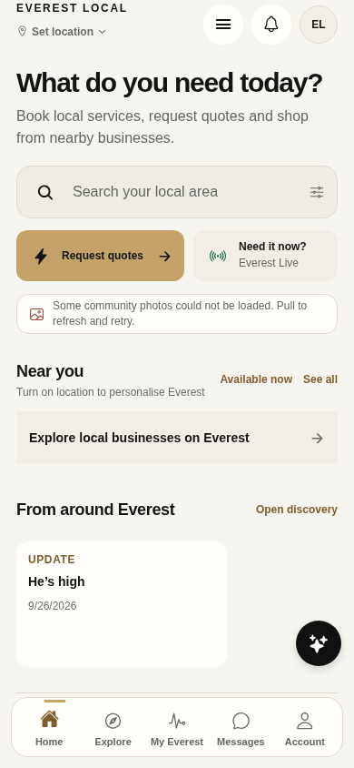
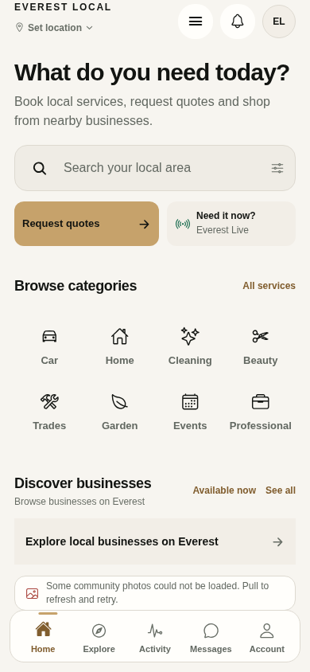
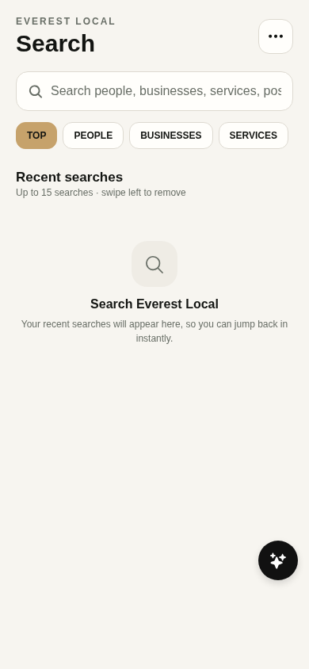
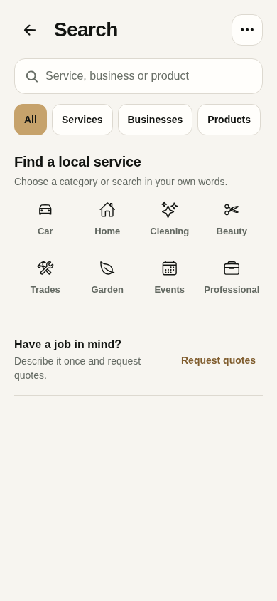

# Experience V2 — Release B: customer discovery

Branch: `codex/customer-discovery-2026-10-12`, PR #99, based on main after Release A merged as `e3f8761`. The release also contains the user-requested beige palette and typography foundation; see [the typography record](experience-v2-typography.md).

## Working changes

- Home places eight service categories immediately after search/quote/Live intent controls, before business and community content. A shared `ServiceCategoryGrid` uses the existing theme tokens; it communicates intents without claiming listings exist.
- Quote/Live actions remain compact at 320 px. Activity navigation label is readable. Home and Search keep assistant access through navigation/menu rather than an overlapping draggable control.
- Global fallback business/product content is no longer titled "Near you" / "Shop nearby". The community media warning sits beside the affected content instead of ahead of service discovery.
- Blank Search provides categories and a quote entry point; recent history appears when it exists. Services, businesses and products precede social filters. Back and clear controls are labeled, inputs remain 16 px, tabs announce selection, and result rows use readable type and separators.
- Search invalidates requests before the debounce begins and aborts obsolete transport, preventing old results under a new query/tab. Network failure has a retry action. Current anonymous permission failure offers sign-in without claiming guest search has been enabled; query/tab are saved to the route before account entry.
- Search modal motion honors reduced-motion preference. Existing backend, history, job-search access, quote/cart authority, payment rails and country behavior are preserved.

## Visual QA loop

Captured baseline → implemented → captured → inspected → refined → captured again. The first comparison found 320 px action wrapping and an assistant overlay over discovery content; both were refined. Browser checks found missing selected-tab ARIA semantics; explicit selected state was added and retested.

| Surface, 390 × 844 | Before | After |
| --- | --- | --- |
| Home |  |  |
| Search |  |  |

[320 px Home capture](experience-v2-evidence/home-after-320.png). Full session captures also cover 360, 375, 430, 768 and 1440 px. These are browser screenshots, not photographs of physical phones.

## Validation

- Typecheck: passed.
- ESLint: zero errors / 12 existing warnings; no new warnings.
- Full Node suite: 410 passed / zero failed, including security, messaging, booking, dispatch, commerce, staff, financial and native-store source invariants. These do not substitute for authenticated end-to-end journeys.
- Web export: passed; no added application dependencies.
- Categories heading moved from y=881 to y=348 in comparable 390 × 844 captures, bringing discovery above the first fold (533 px earlier). This measures layout placement, not conversion improvement.
- Static and migration audits: passed. No migration or function deploy required by these changes.
- Chromium: Home startup request isolation; selected/inert scenes; vertical versus horizontal gestures; Home return; menu; action target bounds; reduced-motion preference and 42 appearance/width combinations. Search: 42 combinations (seven widths × three appearance modes × two themes), categories, permission guidance, delayed old response during debounce, no-results, clear, network failure/retry and back.
- Search permission/failure/empty/stale-result tests use explicitly documented transport fixtures. They do not create records or pretend to validate financial/backend authority. Baseline and Home fetch measurements use real anonymous reads.
- Local WebKit passed the same Home/Search matrix and interaction checks after supplying missing browser libraries in a private tooling runtime. Its automated drag initially triggered the intentionally supported two-page flick; pointer/transform tracing confirmed navigation to the protected Activity/auth route. The one-page drag test now uses a controlled 300 ms gesture rather than depending on browser automation delivery speed. No application spring/gesture threshold was changed to satisfy that test.
- Existing PR #98 CI WebKit chat regression passed. B adds isolated Chromium/WebKit browser CI plus quality checks on its own head. Confirm results before merging. Linux WebKit emulation is not physical iPhone Safari or native iOS.
- Local Expo Doctor: 16/18 checks passed; Expo API / RN Directory network checks failed from this environment. A's GitHub Expo Doctor passed. B's CI reruns it.

Local exported preview is served at `http://localhost:8083` inside the execution workspace. Vercel deployment listing failed with team-scope 403 and the scoped CLI had no credentials. Git integration now produces public previews. The branch URL is https://everest-local-app-git-codex-customer-d-44938d-dakshgolani5-4632.vercel.app/. Verify `/build-info.json` against the final head and run interactions before promotion. API/CLI scope failures do not mean this Git preview is unavailable.

## Performance and rollout limits

Release A measured 70% fewer Home startup REST requests. B adds a small static category grid and prevents superseded searches from continuing; it makes no additional fps/startup timing claim. Main-thread bundle execution still has long tasks. Native scrolling, haptics, font rendering, background/foreground behavior, virtual keyboard sizing and screen-reader traversal need real device/simulator validation.

All 96 screens are inventoried in [the coverage record](experience-v2-screen-inventory.md); authenticated screens remain explicitly unverified. [Reference and license research](experience-v2-research.md) records source/observation limits and implementation decisions.

## Next implementation sequence

1. Validate the final typography/palette preview and exact production provenance. Authenticated customer/business transaction testing remains a separate backend release gate. A is deployed and its production navigation suite passed; hosting through Git integration works.
2. Finish B's service/business details and request/booking UX using controlled customer/provider accounts, authoritative status and actual backend error cases.
3. Improve Business Today from real owner/employee queues: current Today performs broad CRM queries and embeds all messages in its conversations query. Profile this before replacing it with bounded priority reads; validate each role and server permission.
4. Coordinate PR #97 migrations, Edge Functions and anonymous discovery in staging; then verify Stripe sandbox redirects, webhook confirmation, inventory and lifecycle. Do not merge its old main blindly.
5. Refine social/Live while preserving PR #96 messaging. The existing media permission failure is a backend readiness issue, not solved by hiding the error. Live UI expansion is distinct from the dispatch deadline.
6. Reconcile #93/#94 as a separate India release. Validate country scoping, country-stamped onboarding, dispatch migration/functions and checkout/cart boundaries; keep India payments disabled until actual readiness.

Releases C–F are not implemented or represented as complete in this session. Backend, authenticated runtime and native-device verification are their next concrete gates.
